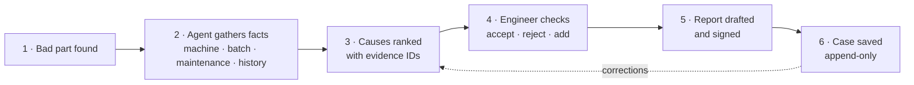
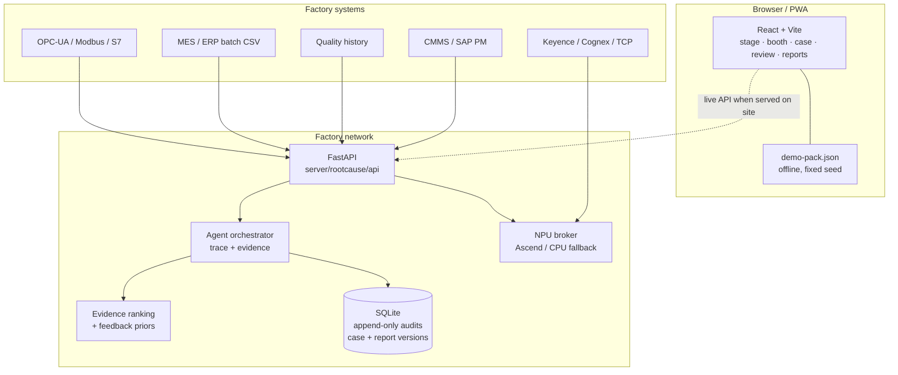

# RootCause

**When a factory finds a bad part, RootCause finds the likely cause and writes the quality report — with evidence — in hours, not days.**

[**Play the 90-second teardown →**](https://jiuwendemos.github.io/rootcause/#/stage) · [**Open the functional demo →**](https://jiuwendemos.github.io/rootcause/#/booth) · [**Pilot dashboard →**](https://jiuwendemos.github.io/rootcause/#/dashboard)

[](https://github.com/jiuwendemos/rootcause/actions/workflows/ci.yml)
[](https://github.com/jiuwendemos/rootcause/actions/workflows/pages.yml)


> *It wasn't fatigue. It started in the casting.*

A camera can see a defect in a second. Finding the cause can take days. Engineers dig through
machine settings, material batches, maintenance logs, old defects and operator notes. Then they
meet, guess, test and write a report. RootCause gathers the facts, ranks the likely causes, shows
the evidence and drafts the quality report. **The engineer stays in charge.**

---

## What is in this repository

| Surface | What it is | Try it |
|---|---|---|
| **Stage piece** | A deterministic 90-second teardown: lens, optical→x-ray depth, a wrong first answer, a human rejection, a re-rank and a stamped verdict. | [`/#/stage`](https://jiuwendemos.github.io/rootcause/#/stage) |
| **Booth demo** | Four real-shaped scenarios — casting, injection moulding, laser welding, SMT reflow — with the whole data trail exposed. | [`/#/booth`](https://jiuwendemos.github.io/rootcause/#/booth) |
| **Case workspace** | Photos, bounding box, machine window, batch, maintenance, similar cases, agent trace, ranked causes and factor weights. | [`/#/cases/RC-0417`](https://jiuwendemos.github.io/rootcause/#/cases/RC-0417) |
| **Engineer review** | The phone version. Accept, reject with a reason, add a cause the AI missed. | [`/#/review`](https://jiuwendemos.github.io/rootcause/#/review) |
| **Reports** | Inline editing, a version per save, sign-off, print/PDF, HTML, Markdown and Word-compatible export. | [`/#/reports`](https://jiuwendemos.github.io/rootcause/#/reports) |
| **Watchlist** | Risk before the next defect: signals, watch cases, owner, SLA, precision and coverage. | [`/#/watchlist`](https://jiuwendemos.github.io/rootcause/#/watchlist) |
| **Watch case** | Why now, evidence, suggested checks, human-approved containment, exposure and genealogy. | [`/#/watch/W-1042`](https://jiuwendemos.github.io/rootcause/#/watch/W-1042) |
| **Shift brief** | Generated start-of-shift risks, open cases, actions due and “fixed but not verified”. | [`/#/brief`](https://jiuwendemos.github.io/rootcause/#/brief) |
| **Alert center** | Deduplicated notifications, quiet hours, digest, signed webhook and alert fatigue. | [`/#/alerts`](https://jiuwendemos.github.io/rootcause/#/alerts) |
| **Proactive control room** | Precision, triage, coverage, thresholds, pattern governance, follow-through and the research gate. | [`/#/proactive`](https://jiuwendemos.github.io/rootcause/#/proactive) |
| **Pilot dashboard** | Time to cause, accuracy, scrap prevented, top causes, trends, corrective actions and baselines. | [`/#/dashboard`](https://jiuwendemos.github.io/rootcause/#/dashboard) |
| **Connectors** | OPC-UA, Modbus, camera feeds, MES CSV, CMMS, SAP QM/PM, FactoryTalk, S7 and a generic REST path. | [`/#/connectors`](https://jiuwendemos.github.io/rootcause/#/connectors) |
| **Admin** | Lines, users, billing, NPU option, compliance evidence maps and opt-in cross-factory sharing. | [`/#/admin`](https://jiuwendemos.github.io/rootcause/#/admin) |
| **Mobile capture** | A photo of a defect starts an investigation; the image is processed on site and not retained. | [`/#/capture`](https://jiuwendemos.github.io/rootcause/#/capture) |

The public site is a **static, offline build** of the same product UI, driven by a synthetic demo
pack. The API and the pilot workflow live in [`server/`](server/) and run on site.

---

## The trust beat

The AI is wrong once, on purpose. The first answer is **tool mark / operator error** at 38%. It is
plausible: a machining ridge sits 7 mm from the crack. The engineer rejects it because **the crack
starts 0.4 mm below the surface; tool marks are surface-only**. The system re-ranks in the same
scene: **gas porosity 48%**, aligned with the crack path. The correction is saved to the case.

That is the product in one minute: evidence, a human decision, and a system that updates.

---

## How it works



**The ranking is deliberately simple and auditable.** Every cause scores on five visible factors:

| Factor | Weight | Where it comes from |
|---|---:|---|
| Machine deviation magnitude | 30% | Time-window z-scores against each parameter's own baseline |
| Known failure-mode frequency | 28% | Previous cases and process priors |
| Batch / material match | 18% | MES batch record, supplier certificate, exceptions |
| Similar-case match | 18% | Cause, material and time-to-resolution features |
| Recurrence on this line | 6% | Six-month case history |

Confidence is a temperature-scaled softmax that **includes a “none of these” bucket**. The list is
never allowed to look 99% certain just because it is the only list on screen. The engineer's
rejections lower a cause's weight and are stored as corrections; historical corrections apply a
small prior penalty on the next iteration.

---

## What is real, and what is simulated

This is written down in the app (top-right of the booth and in every case's provenance panel), not
hidden in a footnote.

| Real | Simulated for the public demo |
|---|---|
| The ranking engine, factor weights, confidence and re-rank | Sensor series, batches, cases and defects |
| The human reject / accept / manual-cause workflow | The precomputed detections and bounding boxes |
| Append-only audit trail and report versioning | Factory hardware (no PLC or camera is attached) |
| Report rendering, exports and sign-off record | NPU latency and connector handshakes |
| The image detector (`Otsu + connected components`), tested | The fine-tuned production model |
| OPC-UA, Modbus, camera, MES, SAP, S7 adapters | Live tags from a customer line |

No customer data and **no MVTec AD images** are used. MVTec AD is CC BY-NC-SA 4.0 and is restricted
to internal R&D. Every public asset is generated in-house; see
[docs/data-provenance.md](docs/data-provenance.md).

---

## Quick start

### The public demo (no install)

Open <https://jiuwendemos.github.io/rootcause/>. It runs fully offline after the first load. Press
`R` on the stage piece to reset.

### Run locally

```bash
# terminal 1 — build the demo pack and the web app
python scripts/build_demo_pack.py
cd web
npm install
npm run dev            # http://localhost:5173

# terminal 2 — the on-site API (optional; dev server proxies /api)
cd server
pip install -e ".[dev,pdf,docx]"
uvicorn rootcause.api.app:app --reload --port 8000
```

On Windows, `npm.cmd` is the reliable entry point if script execution is restricted. The tests use
the Python environment already available on this machine:

```powershell
$PY = "C:\Workspace\openjiuwen\jiuwenswarm\.venv\Scripts\python.exe"
& $PY -m pip install -e "server[dev,pdf,docx]"
& $PY -m pytest -q server
& $PY -m ruff check server
```

### Run it as one on-site service

```bash
docker compose up --build
# open http://127.0.0.1:8000
```

The API serves the built SPA if `web/dist` exists. Data and the append-only case store live in the
`rootcause-data` volume. No outbound network is required after setup. For the optional NPU broker:

```bash
docker compose --profile npu up --build
# then set ROOTCAUSE_NPU=ascend and ROOTCAUSE_NPU_ENDPOINT=http://npu-broker:7788
```

See [docs/deployment.md](docs/deployment.md) and the systemd units in [`deploy/`](deploy/).

---

## Architecture



**Repository layout**

```
rootcause/
  server/rootcause/
    api/           FastAPI routes, uploads, exports
    engine/        ranking · investigation · orchestrator · detection · reporting · analytics · feedback
    connectors/    OPC-UA, Modbus, camera, MES, SAP, FactoryTalk, S7, REST, normalisation
    store/         SQLite case store, audit triggers, report versions, corrections
    npu/           local + Ascend broker and broker service
    training/      fine-tuning and OM export path
    proactive/     signals · scheduler · watch cases · containment · notifications · brief · metrics · queue · privacy
    research/      gated predictive-research harness
    demo/          deterministic demo pack builder
    data/          generated demo pack (committed for offline builds)
    tests/         ranking, detection, store immutability, API flows
  web/             React + Vite product UI and static demo
  docs/            stage script · architecture · pilot · data rights · compliance · roadmap
  deploy/          systemd units
  scripts/         demo pack generator
```

---

## Connectors and the on-site NPU

- **OPC-UA** — 10–20 machine parameters from SCADA; `asyncua` when installed, simulated otherwise.
- **Modbus** — older PLC fallback; `pymodbus`.
- **Camera** — Keyence / Cognex / generic TCP/IP; frame bytes stay on site, only metadata crosses
  the API boundary in the demo.
- **MES / ERP** — batch CSV import, normalisation, tag mapping and QC counters.
- **Quality history** — six-month case import for similar-case search.
- **CMMS / SAP QM / SAP PM / FactoryTalk / S7 / REST** — adapters and a connector library that
  shortens the next deployment.
- **NPU broker** — the product never pretends the CPU is an NPU. If the Ascend runtime or `.om`
  model is missing, the broker returns 503; otherwise it reports its backend and latency with every
  detection.

Fine-tuning code lives in [`server/rootcause/training/finetune.py`](server/rootcause/training/finetune.py).
It validates a YOLO dataset, trains, evaluates and prints the exact Ascend ATC export commands.

---

## Pilot in 90 days

One line, one defect type, one factory. Run alongside the existing process, not replacing it.

1. Record the current investigation time (baseline on day one).
2. Connect OPC-UA, the inspection camera and the batch record.
3. Load six months of quality history.
4. Run 10–20 real investigations with an engineer in the loop.
5. Measure time to cause, first-cause acceptance, scrap and rework prevented, engineer hours saved.
6. Review accuracy weekly; corrections feed the next ranking iteration.

No line control. No automatic rejection. No factory data leaving the site. Read the full offer in
[docs/pilot-90-days.md](docs/pilot-90-days.md).

---

## Status and roadmap

- **Stage piece** — built and playable; deterministic, reset in under five seconds, keyboard `R`.
- **Functional demo** — built; four scenarios, full case workspace, offline pack.
- **Pilot workflow** — built: connectors, ranking, review, report versions, audit, dashboard,
  deployment, NPU broker, training path.
- **Production scale** — connector library, multi-line, multi-factory, compliance evidence maps,
  billing/admin and opt-in anonymised sharing are in the product UI and API; legal/compliance
  validation remains a customer-specific exercise.
- **Proactive quality** — built. Phase 4 adds risk signals, watch cases, human-approved containment
  recommendations, shift briefs and a proactive control room: proactive about risk before the next
  defect, never predictive control of the line. See [Phase 4](docs/roadmap.md#phase-4--proactive-quality-implemented).
- **Predictive research** — gated and currently stopped. The harness is in `server/rootcause/research`
  and the result is recorded in the app. See [predictive research](docs/predictive-research.md).
- **Interface 2026** — shipped, not planned. Instrument shell, command palette, decision-queue Now,
  watch board, evidence docks, light desk mode, density, type/token system, chart data tables,
  focus mode, URL-addressable case panes and a living design catalogue. Validation harness is in
  [Interface 2026](docs/interface-2026.md); live usability sessions belong to the pilot.
- **Workspace data mode** — the app opens in **My workspace**: blank, and your own cases are stored in this
  browser. Switch to the synthetic reference workspace from Admin, the command palette, the More sheet or the
  Home empty state. Reference-only pages (watchlist, alerts, proactive, brief, dashboard, capture) show an
  explicit guard while you are in My workspace. See [the demo runbook](docs/demo-runbook.md).
- **Example own case** — a filled-in pump-housing case with a loupe image, a sensor window and a batch
  record in web/public/examples/pump-housing. Load it from **My cases**, or recreate it by hand. The app
  parses the CSVs, reports the vacuum rise and the hydrogen exception, and ranks gas porosity above the
  engineer's initial ejector-pin guess, with prevention checks and a falsifier. See
  [the example case](docs/example-case.md) and the
  [1:40 walkthrough](web/public/demo/rootcause-walkthrough.mp4).
- **LAIX decision layer** — the generic layer is a pinned dependency (`laix @ v0.6.0`); RootCause
  supplies the quality intervention policy as a plugin. The adapter maps quality signals into LAIX
  and back to watch / check / notification actions, and `/api/laix/*` exposes the decisions and
  outcomes. See [the LAIX module](docs/laix-module.md).
- **Manager proof and demo cut** — `/proof` packages the manager's numbers with honest labels and a
  print view; `/cut` is the 10-minute guided run with a clock, links and proof points. Scripts,
  props, reset and fallback are in [the demo runbook](docs/demo-runbook.md).
- **Production wiring** — JiuwenSwarm `DeepAgent` adapter, ONNX/Ascend inference broker, real
  connector paths and an explicit readiness gate. With `ROOTCAUSE_STRICT_INTEGRATIONS=1`, the API
  refuses to report ready until the agent, inference backend and a live plant connector are
  configured. A production data mode also refuses a store that still holds synthetic cases. See
  [production wiring](docs/production-wiring.md).

The full checklist, with the evidence for each item, is in [docs/roadmap.md](docs/roadmap.md).
The service-by-service integration status — coded, wired, running and why each exists — is in
[docs/integration-status.md](docs/integration-status.md).
The original concept and stage plan are in `agentic-desk`; this repository is the implementation.

---

## Data rights

- Public demo data is **synthetic**, generated in-house with a fixed seed. Licence: MIT.
- MVTec AD is **not** used; it is non-commercial.
- Customer images require **written demo-use permission**, not just a pilot NDA.
- The on-site store keeps images, batches and serials on the factory network.
- Cross-factory sharing is **off by default**, opt-in and anonymised: cause labels and factor ranges
  only — never images, batches or machine identifiers.

---

## Licence

MIT. See [LICENSE](LICENSE).

Built as a demonstration of evidence-first root-cause analysis for factories. The engineer owns the
decision; no automatic line control is performed.
